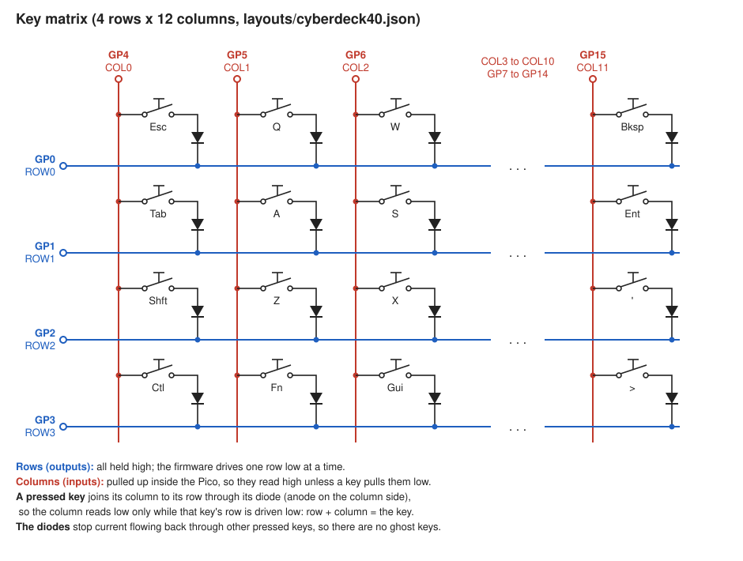

# PICO Cyberdeck Keyboard

A tiny, highly configurable keyboard for a cyberdeck, up to 170mm across,
built around a Raspberry Pi Pico and C&K PTS645 6x6mm surface mount tactile
switches (the same switches as the Cheesebox PCB in [Gerbers.zip](Gerbers.zip)).

The keyboard is described by a JSON layout file. Three programs share it:

| Program | Runs in | Makes |
|---|---|---|
| [designer/keyboard_designer.py](designer/keyboard_designer.py) | Python on the PC (tkinter) | the layout JSON |
| [kicad/build_pcb.py](kicad/build_pcb.py) | KiCad 8 | the PCB (`.kicad_pcb`) |
| [freecad/build_case.py](freecad/build_case.py) | FreeCAD 1.0 | the case and keytops (`.stl`) |

There is also firmware that reads the same JSON, so the key matrix and key
codes always match the board. There are two versions, which do the same job:
[firmware/code.py](firmware/code.py) for CircuitPython, and
[firmware/micropython/main.py](firmware/micropython/main.py) for MicroPython.

All three programs import [common/keyboard_layout.py](common/keyboard_layout.py),
which holds the layout format, the defaults, the hardware dimensions, and the
geometry and validation code. The designer, the PCB and the case therefore all
agree about where everything is.

The whole design was developed in a conversation with Claude (Claude Code),
recorded in [docs/development-conversation.md](docs/development-conversation.md):
every request, the replies, and the actions taken, from the first idea to the
finished keyboards.

## Workflow

1. **Design the layout**

   ```
   python designer\keyboard_designer.py layouts\cyberdeck40.json
   ```

   Move keys around, set labels and keycodes, place the Pico and the mounting
   holes, then save. The problems list at the bottom shows anything that
   won't work: keys that overlap, a case wider than the limit (170mm by
   default, set on the Case tab), mounting holes
   that hit keys, matrix pin clashes, and so on. Click a problem to select
   the parts involved.

2. **Make the PCB**

   ```
   "C:\Program Files\KiCad\8.0\bin\python.exe" kicad\build_pcb.py layouts\cyberdeck40.json
   ```

   or, inside the KiCad PCB editor, open **Tools > Scripting Console** and run

   ```python
   exec(open(r"D:\GitHub\PICO-Cyberdeck-keyboard\kicad\build_pcb.py").read())
   ```

   which asks for the layout file. Either way it makes a complete KiCad
   project in `output\<name>\`: the board (`<name>.kicad_pcb`) and its
   schematic (`<name>.kicad_sch`). Open `<name>.kicad_pro` in KiCad. Every
   part is placed, and the tracks are added by the built-in autorouter (see
   [Tracks](#tracks) below). It also writes everything needed to have the
   boards made, in `output\<name>\fabrication\` (see
   [Having the boards made](#having-the-boards-made)).

3. **Make the case**

   In FreeCAD, use **Macro > Macros...** and execute `freecad\build_case.py`,
   which asks for the layout file. It can also run without the GUI:

   ```
   set CYBERDECK_LAYOUT=D:\GitHub\PICO-Cyberdeck-keyboard\layouts\cyberdeck40.json
   "C:\Program Files\FreeCAD 1.0\bin\freecadcmd.exe" freecad\build_case.py
   ```

   This writes `Tray.stl`, `Plate.stl`, `Keycaps.stl`, `KeycapLegends.stl`,
   `MockPCB.stl` (see [Trying out long keys](#trying-out-long-keys)),
   `Cutout.stl` (see below) and a `.FCStd` model
   (with reference PCB, switches and Pico) to `output\<name>\`.

   **Fitting the keyboard into another case.** You can leave out the tray
   and plate and build the keyboard into a cyberdeck's own case:

   * `Cutout.stl` is not for printing. It is the plate's key holes as
     solids, one per key, for cutting the same holes in a panel of your
     case. That panel then does the plate's job: the keytops sit in its holes
     and their lips hold them in. Make the panel 1.5mm thick, like the plate
     (or set `case.plate_thickness` to your panel's thickness and build
     again). Line the cutters up so that their top is 1mm above your panel's
     top face (their bottom is then 0.3mm below its underside), and subtract
     them. They are in the
     same place as the holes in `Plate.stl`, so you can import the two
     together to check.
   * `PillarsUnderneath.stl` is a pillar for each mounting hole, for fixing
     the PCB under that panel. They are 7.3mm long, which holds the PCB where
     it would be under the keyboard's own plate, so the switches, keytops and
     their free play all fit. They stand exactly where the plate's own
     pillars are.
   * `PillarsOnTop.stl` is a pillar for each mounting hole, for fixing the
     PCB (or the mock PCB) on top of a plate. They are 4mm high
     (`pillars.on_top_height`, "On top pillar height" on the designer's Case
     tab). A Pico soldered on the back of the PCB stands about 4.2mm proud of
     it, so with 4mm pillars it would press on the plate: make them 4.5mm or
     more, or cut a hole in the plate under the Pico. The designer warns
     about this.

   All the pillars are tubes as wide as the keyboard's standoffs (5mm), with
   a 1.8mm pilot hole right through for M2 self tapping screws from either
   end. Print them standing up. If you use the keyboard's own tray, leave
   a way in for the USB cable, which comes out through its side.

4. **Program it**, with either CircuitPython or MicroPython:

   * **CircuitPython**: copy `firmware\code.py` to the Pico as `code.py`,
     your layout as `layout.json`, and the `adafruit_hid` library into `lib`.
   * **MicroPython**: see [Installing the MicroPython firmware](#installing-the-micropython-firmware)
     below. MicroPython has no `keypad` module, so this version scans the
     matrix itself every 5ms, driving each row low in turn and reading the
     columns. It debounces in the same way as the CircuitPython version (see
     [Trying out long keys](#trying-out-long-keys)), using the same
     `firmware` settings from the layout.

### Installing the MicroPython firmware

A Pico running MicroPython doesn't appear as a USB drive (unlike
CircuitPython), so files are copied to it with a program that talks to it
over USB. These steps use [Thonny](https://thonny.org), copying everything
by hand. If you prefer the command line, `mpremote` does the same job: see
the end of this section.

**1. Put MicroPython on the Pico.** It must be version **1.23 or later**,
the first that can be a USB keyboard.

* Download the `.uf2` file for your board from
  [micropython.org/download](https://micropython.org/download/): `RPI_PICO`
  for a Pico, `RPI_PICO_W` for a Pico W.
* Hold down the Pico's **BOOTSEL** button while you plug it in. It appears
  as a drive called `RPI-RP2`.
* Copy the `.uf2` file onto that drive. The Pico restarts running
  MicroPython, and the drive disappears.

**2. Connect Thonny to it.** In Thonny, choose **Tools > Options >
Interpreter**, pick **MicroPython (Raspberry Pi Pico)**, and choose its port
(or leave it on "try to detect port automatically"). Then turn on **View >
Files**. The Files pane shows "This computer" at the top and "Raspberry Pi
Pico" underneath.

**3. Copy the USB keyboard driver.** It is four files from
[micropython-lib](https://github.com/micropython/micropython-lib/tree/master/micropython/usb),
which all go in one folder on the Pico, `/lib/usb/device/`:

| On the Pico | From micropython-lib |
|---|---|
| `/lib/usb/device/__init__.py` | `micropython/usb/usb-device/usb/device/__init__.py` |
| `/lib/usb/device/core.py` | `micropython/usb/usb-device/usb/device/core.py` |
| `/lib/usb/device/hid.py` | `micropython/usb/usb-device-hid/usb/device/hid.py` |
| `/lib/usb/device/keyboard.py` | `micropython/usb/usb-device-keyboard/usb/device/keyboard.py` |

* Get the files: download micropython-lib as a zip from GitHub (**Code >
  Download ZIP**) and unzip it, or use a clone of it.
* In the Pico's part of the Files pane, make the folders: right click,
  **New directory...**, and make `lib`. Go into it, make `usb`, go into
  that, and make `device`. (If `lib` is already there, just go into it.)
* With the Pico's pane showing `/lib/usb/device`, find each of the four
  files in the "This computer" pane, right click it, and choose **Upload
  to /lib/usb/device**.

**4. Copy the firmware and your layout.**

* In the Pico's pane, go back to the top folder (`/`).
* In "This computer", find `firmware\micropython\main.py` in this
  repository, right click it, and choose **Upload to /**. MicroPython runs
  `main.py` whenever the Pico starts.
* Upload your layout file from `layouts\` the same way, for example
  `numpad.json`. Then, in the Pico's pane, right click it, choose
  **Rename...**, and call it `layout.json`, which is the name the firmware
  looks for.

The Pico should now hold:

```
/
|-- main.py
|-- layout.json
`-- lib/
    `-- usb/
        `-- device/
            |-- __init__.py
            |-- core.py
            |-- hid.py
            `-- keyboard.py
```

**5. Start it.** Unplug the Pico and plug it in again (or press the reset
button if your board has one). `main.py` starts, and the Pico appears to the
computer as a USB keyboard. Open a text editor and press some keys.

**Changing things later.** The Pico keeps its USB serial port while it is
being a keyboard, so Thonny can still connect. Press Thonny's **Stop**
button (or Ctrl-C in the Shell) to stop the keyboard program. Then you can
copy files, for example a new `layout.json`. Unplug and plug in again to
start the keyboard again. While the program is starting, the Pico briefly
disconnects and reconnects as a keyboard, so Thonny may say the device has
gone away. Press **Stop** to reconnect.

**If it doesn't type.** In Thonny, press **Stop**, open `main.py` from the
Pico, and run it with the green **Run** button so you can see any error in
the Shell:

* `ImportError: no module named 'usb.device'` means the driver files are
  missing, or not in `/lib/usb/device/`.
* `OSError: [Errno 2] ENOENT` means `layout.json` is missing, or has another
  name.
* `Unknown keycode ...` means a key in the layout has a keycode the firmware
  doesn't know. Check it in the designer.
* `AttributeError` about `USBDevice` means the MicroPython version is older
  than 1.23. Type `import os; os.uname()` in the Shell to see the version.

**Testing the keys.** Set `DEBUG = True` near the top of `main.py` (open it
from the Pico in Thonny, change it, and save it) and run it. The Pico then
doesn't become a keyboard: it prints each key's legend, row and column in
the Shell as it goes down and up, which keys are down, and what a keyboard
would send. A press at a matrix position with no key is shown too. Set it
back to `False` to use the keyboard again.

**With the command line instead.** `mpremote` (`pip install mpremote`) does
steps 3 and 4 in one go, fetching the driver from the internet:

```
mpremote mip install usb-device-keyboard
mpremote cp firmware/micropython/main.py :main.py
mpremote cp layouts/numpad.json :layout.json
```

## Parts list

Each keyboard's parts list is made from its layout file by
[common/parts_list.py](common/parts_list.py), so it always matches the
design. It covers:

* **Electronics:** the PCB size, switches (including the extra switches under
  long keys), diodes, the Pico and how it is mounted, and a USB cable.
* **Hardware:** the fixing screws and their length.
* **Printed parts:** each STL file, its colour, and the filament it needs.
* **Keytops:** a count of each keytop size.
* **Summary:** the case size and the key matrix pins.

It is written to `output\<name>\parts_list.md` (to read or share) and
`output\<name>\parts_list.csv` (to open in a spreadsheet for ordering) in
three ways:

* in the designer, with **File > Make parts list**
* every time `freecaduild_case.py` builds the case
* from a command prompt:

  ```
  python common\parts_list.py layouts\cyberdeck_staggered.json
  ```

The filament amounts come from the FreeCAD build, which records the volume of
each printed part in `output\<name>\prints.json`. Until the case has been
built, the list has no filament amounts. They are for solid parts, so they
are an upper limit: the slicer will show the real amount for your infill.

## The example layouts

All the examples have the Pico on the back of the board, in the middle, with
its USB socket at the top edge. Every key has one switch in its middle.

* [layouts/cyberdeck_numbers.json](layouts/cyberdeck_numbers.json) is the
  staggered keyboard below with a number row on top: 57 keys in 5 rows, in a
  167 x 77 x 16.9mm case. The number row (`Esc 1 2 3 4 5 6 7 8 9 0 - =`) is
  13 keys wide and starts half a key to the left of the Q row, as on a full
  size keyboard. Esc moves to the start of the number row, and Caps Lock
  takes its place at the start of the A row. On the Fn layer the number row
  gives F1 to F12, Fn+Esc gives `` ` ``, Fn+O, Fn+P and Fn+L give `[`, `]`
  and `\`, Fn+; gives `'`, Fn+. gives `/`, Fn+Bksp is Delete, and the arrow
  keys give Home, End, Page Up and Page Down. It uses 18 of the Pico's pins
  (5 rows, 13 columns). Also **File > New from example (staggered with
  number row)** in the designer.
* [layouts/cyberdeck_staggered.json](layouts/cyberdeck_staggered.json) is a
  44 key keyboard with staggered rows like a full size keyboard. It is 13
  units wide on a 12mm pitch, and the case is 167 x 65 x 16.9mm. The stagger
  comes from the wide keys at the start of each row (Tab 1.5u, Esc 1.75u,
  Shift 2.25u), so Q, A and Z sit 1.5, 1.75 and 2.25 units in, as they do
  on a normal keyboard. The number row, `'` and `/` are on the Fn layer.
  It has mounting holes in the top and bottom margins.
* [layouts/numpad.json](layouts/numpad.json) is a small numeric keypad
  for test prints: four rows of three 1u keys, not staggered, on the same
  12mm pitch as the keyboards above. Digits 1 to 9 fill the top three rows
  (1 2 3 at the top), and the bottom row is DEL (Delete), 0 and RET (Enter).
  The case is 53 x 62 x 16.9mm, and its mounting holes are in the side
  margins beside the rows. Also **File > New numeric keypad** in the designer.
* [layouts/cyberdeck40.json](layouts/cyberdeck40.json) is a 45 key, 4 x 12
  grid (ortholinear) keyboard on an 11.5mm pitch, in a 149 x 60 x 16.9mm
  case. Two of its mounting holes are in the top margin, and two are in the
  gaps either side of the 2u space bar.

## Staggered rows

There are two ways to stagger the rows:

* **Use wider keys at the start of the rows**, as on a real keyboard. In
  **Edit > Add rows of keys**, type `Tab:1.5 Q W E ...`, `Caps:1.75 A S D ...`
  and `Shift:2.25 Z X C ...`.
* **Move whole rows sideways.** The **Add rows of keys** dialog has a
  **Row stagger** setting, and **Edit > Stagger rows...** (also on the right
  click menu) staggers the rows of keys that are already there: the selected
  keys, or all of them if nothing is selected. Pick a preset or type how far
  each row moves right, in key units, top row first:

  | Preset | Units per row |
  |---|---|
  | Standard (QWERTY, ASDF, ZXCV rows) | 0, 0.25, 0.75 |
  | Standard with number row | 0, 0.5, 0.75, 1.25 |
  | Half key (brick) | 0, 0.5, 0, 0.5 |

  Rows after the end of the list don't move, so the bottom row of modifiers
  stays where it is. Undo puts everything back.

Rows are worked out from the key heights: keys within half a pitch of each
other vertically are in the same row. While **Auto assign matrix** is on,
the key matrix is reassigned after staggering. The columns follow the
stagger, so the column wiring runs at a slight slant.

## Trying out long keys

A keytop rests on its switch plunger and is free to tip, so a long key with
one switch in the middle might rock about the switch, rather than press it,
if you press it near an end.

[layouts/switch_test.json](layouts/switch_test.json) (also **File > New
switch test keyboard**) is a small keyboard for trying this out: one key each
of 1u, 1.5u, 2u, 2.25u, 2.75u and 4u, each with one switch in the middle.
Its case is 92 x 41mm, with the Pico lying along the back of the board and
its USB socket at the right hand end. The keys type A to F.

What the tests found:

* **One switch in the middle works for keys up to 4u.** They press properly
  at either end. The designer warns about keys longer than 4u.
* **Two switches under one key make it twice as hard to press,** because
  you have to push both switches down. So none of the layouts use them.

A key can still have more than one switch if you want to try it: its
`switches` list gives where they are, in key units from the middle of the
key (`[0]`, the default, is one switch in the middle, and `[-1.5, 1.5]` puts
the switches of a 4u key half a unit in from each end). Set it in the
**Switches** box on the designer's Key tab, or right click a key. The
switches of a key are wired in parallel, so the key is down for as long as
any of them is closed, and the firmware needs no change. The designer warns
that the key will be harder to press.

You don't need to have a PCB made to try it. The FreeCAD script also makes
**`MockPCB.stl`**, a printed stand-in for the circuit board:

* It is the same shape and thickness (1.6mm) as the real board, with the same
  mounting holes, so it fits the tray and plate in the same way.
* Every switch position has a fence 2.5mm high round the switch body, with
  gaps for the legs. A PTS645 switch pushes in and sits on the surface, at
  the same height it would be if soldered to a real board. The inside of
  the fence leans in: it is 0.15mm clear of the switch body at the bottom,
  and the same size as the body near the top. Printed holes come out a
  little small, so the walls grip the switch. A chamfer at the top guides
  the switch in.
* How well that grips depends on your printer, so the FreeCAD script also
  makes **`SwitchGripTest.stl`**. This is a small plate (72 x 20mm) with six
  fences that grip by 0, 0.05, 0.1, 0.15, 0.2 and 0.25mm, each labelled.
  Print it, push a switch into each fence, and pick the one that holds the
  switch firmly but still lets it go all the way down. On the first test
  print, 0 worked best, so that is the default. Then set that number
  as **Mock PCB grip** on the designer's Case tab (`mock_pcb.grip` in the
  layout) and rebuild the case. The `mock_pcb` section also sets the fence
  height (`fence_height`), wall thickness (`fence_wall`), the clearance at
  the bottom (`body_clearance`) and the chamfer at the top (`lead_in`).
* There is a 1mm hole under each switch leg. To try the switches
  electrically, push wires up through the holes and solder them to the legs.

To build the test keyboard: print `MockPCB.stl` (flat side down), fit the
switches, then put it together like the real keyboard. Put the mock board in
the tray, the keytops in the plate, the plate on top, and screw it together.
The test layout also builds as a real PCB with `build_pcb.py`. It routes
completely, so you can have real boards made for it if you prefer.

Both firmwares scan the matrix every 5ms and ignore any change that doesn't
last for `firmware.debounce_scans` (2) scans in a row, which deals with
ordinary switch bounce.

## How it fits together

Heights from the bottom of the PCB with the default settings (5mm switches):

```
 12.4  keytop surface (legends inlaid 0.6mm deep)
 10.4  top of plate         -- 1.5mm plate, keytops stand 2mm proud
  8.9  underside of plate   -- the lower part of each hole slopes like the shoulder
  8.5  top of the keytop's tapered shoulder
  7.6  top of the straight band round the bottom of the keytop
  6.6  keycap underside, resting on the switch plunger
  5.1  top of switch body
  1.6  top of PCB           -- plate rib and pillars press down here
  0    underside of PCB     -- sits on the tray ledge and standoffs
 -5.0  tray floor           -- 5mm of room for the Pico on the back
 -6.5  bottom of case
```

* Each keytop has a lip (flange) all round its base which is wider than its
  hole in the plate, so the keys are trapped between the plate and their
  switches. Put the keytops into the plate before fitting the plate.
* The lip is a straight band 1mm high (`flange_thickness`), topped by a
  shoulder that slopes in at 45 degrees (`flange_angle`) to the body of the
  key. The lower part of each plate hole has the same slope, so the hole is
  the keytop's shape with `key_clearance` (0.35mm) all round. A keytop pushed
  up by its switch seats on the sloped sides, which centres it and stops it
  catching on a sharp edge.
* There is a gap of 1mm (`plunger_gap`) between a keytop resting on its
  switch and the plate, as well as the clearance on the slope. A keytop can
  rise 1.35mm before it seats against the plate, much more than the 0.25mm
  a PTS645 moves before it clicks. Without this gap, small errors in the
  printed parts could leave keytops pressing their switches when the case is
  screwed together. That happened on the first test print, which had only
  0.35mm. Make `plunger_gap` bigger if it still happens, or smaller for less
  rattle.
* The PCB sits on a ledge round the inside of the tray and is clamped by a
  rib under the edge of the plate. It is also clamped at the mounting holes
  by standoffs in the tray and pillars under the plate.
* M2 self tapping screws go in from underneath, through countersunk holes in
  the tray floor, the standoffs and the PCB, into the plate pillars. The
  designer (Case tab) and the FreeCAD output give the screw length (M2 x
  14mm for the example).
* Print the keytops **top face down** and the tray the right way up.
  `Keycaps.stl` is exported upside down, ready to print. The top of each key
  is then the smooth face against the build plate, and the 45 degree
  shoulder prints without support. Print the plate **top face down** too,
  with its rib and pillars pointing up. `Plate.stl` is exported that way
  round, so don't flip either of them in the slicer.
* Each keytop has 0.35mm of clearance all round in its hole (`key_clearance`).
  This allows for FDM prints coming out with holes a little small and outside
  edges a little big. The keytop's lip sticks out 0.9mm (`flange`), so it
  reaches 0.55mm under the edge of its hole. If the keys stick or rattle on your printer, print
  a row of keytops and a strip of plate to test the fit, and adjust those two
  values on the designer's Case tab.

## Two colour keytops

The keytops are printed in two colours, using the same method as the
[party tags](https://github.com/CrazyRobMiles/Python-in-FreeCAD/blob/main/Examples/21%20Party%20Tags/PartyTags.md)
in Python-in-FreeCAD. The FreeCAD script makes each key's label into solid
letters 0.6mm deep (three 0.2mm layers), level with the top of the keytop.
It then cuts those letters out of the keytop and keeps them as a separate
part. That gives two STL files with all the keys laid out for printing:

* `Keycaps.stl`: the keytops, with letter shaped holes in their tops
* `KeycapLegends.stl`: the letters that fill those holes

The two files share the same coordinates, so the letters sit exactly in
their holes. To print them (Bambu Studio is shown in the Python-in-FreeCAD
example; PrusaSlicer works the same way):

1. Select both STL files and drag them into the slicer together.
2. When asked "Load these files as a single object with multiple parts?",
   click **Yes**.
3. In the Objects list, right click the `KeycapLegends` part, choose
   **Filament**, and pick the colour for the letters.

The keytops print upside down, so the letters are the first three layers,
on the build plate, and come out flush with the smooth top of the key.
Labels are scaled to fit their keytops. Small symbols such as `.` and `,`
are enlarged so they are big enough to see and to print.

Set **Legends** on the designer's Case tab (`case.legend`) to `engrave` for
one colour keytops with sunken letters, or `none` for blank keytops. Neither
of those makes `KeycapLegends.stl`.

## The PCB

* **Switches**: `Button_Switch_SMD:SW_SPST_PTS645` (C&K PTS645 6x6mm SMD,
  pads at +/-3.98, +/-2.25mm, which matches the Cheesebox Gerbers), on the front.
  Pick the switch height in the designer: 4.3, 5.0, 7.0 or 9.5mm.
* **Diodes**: one 1N4148W in `Diode_SMD:D_SOD-123` per key, on the front in the
  gap below its switch. Wiring is `COLn -> switch -> diode anode`, `diode
  cathode -> ROWn`, which suits CircuitPython's `keypad.KeyMatrix` with
  `columns_to_anodes=True`. Turn diodes off in the designer if you want
  (you then risk ghost key presses).
* **Pico**: the footprint is generated by the script. On the **back** it has
  only surface mount pads, and the Pico is soldered flat by its castellations.
  It has no through holes, so the switches on the front can sit right over
  it. On the **front** it also has through holes for headers, and the plate
  gets a window over it.
* **Mounting holes**: `MountingHole:MountingHole_2.2mm_M2`.
* All the SMD parts are on the front, so the board suits JLCPCB-style
  assembly, and you then solder the Pico by hand.

The Pico's GND pins are not connected to anything. Nothing on the board
needs ground, and the Pico joins its own GND pins together.

### Key matrix

This is how the switches are wired, using
[layouts/cyberdeck40.json](layouts/cyberdeck40.json) as the example (other
layouts use different pins: see the layout's `matrix` section). The rows are
outputs and the columns are inputs, pulled up inside the Pico. The firmware
drives one row low at a time and reads the columns: a column that reads low
means the key where that row and column cross is down.



### Having the boards made

Every time `build_pcb.py` builds a board, [kicad/fabrication.py](kicad/fabrication.py)
uses `kicad-cli` (which comes with KiCad) to write
`output\<name>\fabrication\`:

| File | What it is |
|---|---|
| `<name>_gerbers.zip` | **Upload this to order boards.** Gerbers for the copper, solder mask, silkscreen and paste (for a stencil) layers of both sides and the board outline, the Excellon drill files (mm, plated and non plated holes separately), an IPC-D-356 netlist (the maker uses it to test the bare boards), and a Gerber job file. The same files and settings as the PCBWay plugin makes |
| `ORDERING.md` | The settings to choose on the order form, for this board: size, thickness, smallest track, gap and hole, and so on |
| `<name>_bom_top.xlsx`, `<name>_bom_bottom.xlsx` | Only for having the parts fitted: a BOM for each side of the board. The top has the switches and diodes, the bottom the Pico (soldered flat by its castellations). Laid out like PCBWay's sample BOM: the same column headings, title on row 2, headings on row 6. There are `.csv` copies too. A board with its Pico on the front has only a top BOM |
| `<name>_positions_top.csv`, `<name>_positions_bottom.csv` | Only for having the parts fitted: where each part goes on each side |
| `<name>_assembly.zip` | Only for having the parts fitted: the Gerber zip's files plus the BOM and positions, in one zip, for an assembly order form with a single upload box |
| `gerbers\` | The same files as the zip, unzipped, to look at in KiCad's Gerber viewer |

To order from PCBWay: go to **PCB Instant Quote**, upload `<name>_gerbers.zip`,
check the settings against `ORDERING.md`, and submit it for review. The
settings that matter are 2 layers, FR-4, and **1.6mm thick** (the case is
designed for that). Everything on these boards is well inside standard
limits: 0.25mm tracks, 0.2mm gaps and 0.3mm holes. Add a stencil if you will
solder the switches and diodes with solder paste. For assembly, use the
**PCB Assembly** quote form rather than the plain PCB quote, upload the BOM
and positions files for each side (or the assembly zip if there is only one upload box),
which already have the switch's exact part number. The
Pico is on the bottom: leave out the bottom files to solder it yourself, as fitting both sides costs more.

The build checks itself, but you can check a zip yourself too: open it in
KiCad's **Gerber Viewer**, or in PCBWay's online viewer after uploading. The
PCBWay plugin for KiCad (from the Plugin and Content Manager) makes the same
kind of files from the PCB editor with one button, if you change a board
by hand.

### Schematic

`build_pcb.py` also writes a schematic, `output\<name>\<name>.kicad_sch`,
written directly in KiCad's file format by [kicad/schematic.py](kicad/schematic.py)
(KiCad's Python API only covers the PCB editor). It has:

* one cell per key, laid out by its row and column in the key matrix: the
  key's switch (labelled with the key's label), and its diode down to the row
* global labels `ROWn` and `COLn` joining the rows and columns, and
  `K_<key id>` on the link between each switch and its diode
* the Pico, with its row and column pins labelled and a no connect flag on
  every other pin
* a note of the key count, the matrix size and the parts

References, values, footprints and net names are the same as on the PCB,
and each footprint on the PCB is linked to its symbol. So the two files work
as one KiCad project: cross probing works, and so does **Tools > Update PCB
from Schematic**. Mounting holes are marked as not in the schematic.

KiCad has no Raspberry Pi Pico symbol, so each project gets its own small
libraries, `Cyberdeck.kicad_sym` (the Pico symbol) and `Cyberdeck.pretty`
(the Pico footprints, soldered flat or with header pins), listed in the
project's `sym-lib-table` and `fp-lib-table`.

For every example layout, KiCad's electrical rules check (ERC) on the
schematic, and DRC on the board with the schematic parity check, both
report no problems at all.

Don't edit the schematic by hand: change the layout and build again, which
rewrites it.

### Tracks

`build_pcb.py` routes the board itself, using
[kicad/autoroute.py](kicad/autoroute.py), so nothing else needs to be
installed. It is a grid router: the board is divided into 0.5mm cells on the
front and back copper, and each connection is found with an A* search, using
vias to change sides. It keeps the clearance from every pad of another net
(using KiCad's own pad shapes) and from the board edge. If some connections
fail, it routes the board again with those nets first.

The front prefers horizontal tracks and the back vertical ones, so the
matrix rows run along the front in the gaps between the rows of switches,
and the columns run up and down the back. Nothing is routed on the back
under a Pico that is soldered flat there, where its own test pads would
touch the tracks.

Each of the example layouts routes completely in a few seconds, with no DRC
errors and no unconnected items. If a connection ever can't be made, the
script prints a warning and leaves it as a ratsnest line for you to route
by hand.

The settings are in the `routing` section of the layout file:

| Setting | Default | |
|---|---|---|
| `enabled` | `true` | set to `false` for an unrouted board |
| `grid` | 0.5 | routing grid, mm |
| `track_width` | 0.25 | mm |
| `clearance` | 0.2 | mm, between copper of different nets |
| `edge_clearance` | 0.5 | mm, from the board edge |
| `via_diameter` / `via_drill` | 0.6 / 0.3 | mm (JLCPCB standard vias) |
| `via_cost` | 8 | how many grid steps a via is worth, so higher means fewer vias |
| `wrong_way_cost` | 3 | cost of a vertical step on the front or a horizontal step on the back |

The grid is twice the track width, so neighbouring tracks always keep their
clearance. If you make the tracks wider or the clearance bigger, make the
grid bigger too.

## The layout file

Dimensions are in mm. X goes right and Y goes **down**, as in KiCad, looking at
the key side of the board. A key's `x`,`y` is the centre of the key and its
switch. Rotation is in degrees, anticlockwise. Missing values take the defaults
in [common/keyboard_layout.py](common/keyboard_layout.py).

```jsonc
{
  "format": "pico-cyberdeck-keyboard", "version": 1,
  "name": "cyberdeck40",                    // also the output folder name
  "switch": {"type": "PTS645", "height": 5.0, "force": "M"},   // M = 160gf, PTS645SM50SMTR92 LFS
  "grid":   {"pitch_x": 11.5, "pitch_y": 11.5, "snap": 0.5},   // 1u key size
  "keys": [
    {"id": "K1", "label": "Esc", "keycode": "ESCAPE", "fn_keycode": "GRAVE_ACCENT",
     "x": 5.75, "y": 5.75, "w": 1.0, "h": 1.0, "rotation": 0, "switches": [0], "row": 0, "col": 0}
  ],
  "board": {
    "auto_size": true,                      // fit the board round the keys...
    "margin": {"top": 6, "right": 3, "bottom": 3, "left": 3},
    "x": 0, "y": 0, "width": 100, "height": 50,   // ...or use this rectangle
    "corner_radius": 2.0, "thickness": 1.6,
    "mounting_holes": [{"x": 23.0, "y": -3.0, "d": 2.2}]
  },
  "controller": {"type": "pico", "side": "back", "x": 69, "y": 19.5, "rotation": 0},
  "matrix": {"diodes": true, "auto": true, "reserved_pins": [],
             "row_pins": [0, 1, 2, 3], "col_pins": [4, 5, 6, 7, 8, 9, 10, 11, 12, 13, 14, 15]},
  "mock_pcb": {"fence_height": 2.5, "fence_wall": 0.8, "body_clearance": 0.15,
               "grip": 0.0, "lead_in": 0.4},
  "pillars": {"on_top_height": 4.0, "pilot_hole": 1.8},
  "firmware": {"debounce_scans": 2},
  "routing": {"enabled": true, "grid": 0.5, "track_width": 0.25, "clearance": 0.2,
              "edge_clearance": 0.5, "via_diameter": 0.6, "via_drill": 0.3,
              "via_cost": 8, "wrong_way_cost": 3},
  "case": {"max_width": 170.0, "wall": 2.0, "floor": 1.5, "clearance": 0.5, "back_clearance": 5.0,
           "plate_thickness": 1.5, "key_gap": 1.6, "key_clearance": 0.35,
           "key_protrusion": 2.0, "flange": 0.9, "flange_angle": 45.0, "flange_thickness": 1.0,
           "flange_clearance": 0.3, "plunger_gap": 1.0, "hole_diameter": 2.2, "standoff_diameter": 5.0,
           "screw_pilot": 1.8, "ledge": 1.5, "legend": "inlay", "legend_depth": 0.6,
           "font": "C:/Windows/Fonts/arialbd.ttf"}
}
```

* A key's `switches` lists where its switches are, in key units from its
  middle along its length: `[0]` is one switch in the middle (the default).
  See [Trying out long keys](#trying-out-long-keys).
* `switch.force` is the PTS645's press force: `L` 130gf, `M` 160gf (medium,
  the default), `H` 200gf or `K` 260gf. With `switch.height` it sets the
  switch's part number in the BOM, parts list and schematic, for example
  `PTS645SM50SMTR92 LFS` (surface mount, 5.0mm high, 160gf). It is also on
  the designer's Case tab.
* `case.max_width` is the widest the case is allowed to be. The designer
  flags anything wider as an error.
* A keytop is `w x pitch - key_gap - 2 x key_clearance` wide. With the
  defaults, a 1u keytop is 9.7mm square on a 12mm pitch (9.2mm on 11.5mm).
* Controller `rotation` 0 puts the USB socket at the top (towards -Y). Put the
  USB end against a board edge and the case gets a slot for the cable.
* While `matrix.auto` is true, the designer gives every key a row (by height)
  and a column (by X position), and allocates GPIO pins in order, skipping
  `reserved_pins` (keep pins free for a display, for example).
* `keycode` and `fn_keycode` are
  [adafruit_hid Keycode](https://docs.circuitpython.org/projects/hid/en/latest/api.html#adafruit-hid-keycode-keycode)
  names. `FN` marks the function key.
* When saving, the designer also writes a `derived` section (board rectangle,
  case size and heights) for reference. The other programs ignore it.

## Designer controls

| | |
|---|---|
| click / shift+click | select / add to selection |
| drag | move (in steps of the snap distance) |
| drag on empty space | select keys in a rectangle |
| double click | add a key |
| right click | add key or mounting hole, rotate, delete, flip the Pico to the other side |
| wheel / middle drag | zoom / pan, **F** fits the view |
| arrows, Delete, Ctrl+D | nudge, delete, duplicate |
| `[` `]` | rotate selected keys 5 degrees |
| Ctrl+Z / Ctrl+Y / Ctrl+S | undo / redo / save |

**Edit > Add rows of keys** lets you type a layout in, one row per line
(and optionally stagger the rows):
`Esc Q W E R T Y U I O P Bksp`. Give a key a width with `Space:2`. An
underscore `_` is a gap and `_:0.5` is a half gap.

Changing the key pitch spreads the keys out or pulls them in to match.

## Licence

This project is released under the [MIT License](LICENSE): you can use,
copy, change and share it, including in your own keyboards and products, as
long as the copyright notice and licence go with it.
